# Masovian Drift: Project Summary & Architecture Review

> **Next-Generation Browser-Based AAA Voxel Racing Engine**  
> *Rooted in Polish drifting culture and the architectural heritage of the Masovian landscape (Świdermajer villas of Otwock and Józefów, pine forests, and sandy Świder riverbanks).*

---

## 1. Executive Summary & Vision

**Masovian Drift** is a state-of-the-art WebGPU and Three.js voxel racing and drifting simulation running entirely in the browser. The engine combines high-fidelity arcade-simulation vehicle dynamics (Pacejka '94 Magic Formula, 4-point raycast suspension, 3-zone thermal tire models, and 2-way spool differentials) with advanced real-time voxel graphics, procedural audio synthesis, and serverless peer-to-peer multiplayer.

Rooted in the distinctive automotive and cultural atmosphere of Polish motorsport, the game features a 1.6 km circuit winding through the pine woods, sandy dunes, and historic wooden Świdermajer villas of Otwock and Józefów (a style pioneered by Michał Elwiro Andriolli in the 1880s blending Mazovian folk carving, Russian dacha verandas, and Alpine woodwork).

---

## 2. Technical Architecture & Engine Subsystems

```mermaid
graph TD
    A[Vite & TypeScript Engine Core] --> B[Renderer: Three.js + WebGPU Shaders]
    A --> C[Physics: Rapier3D + Pacejka 94]
    A --> D[bitECS Structure-of-Arrays Pipeline]
    A --> E[Procedural WebAudio Synthesizer]
    A --> F[Networking: WebRTC P2P + QWBP QR]
    
    B --> B1[Radiance Cascades Indirect GI]
    B --> B2[Screen-Space Reflections SSR]
    B --> B3[ACES Tone Mapping & Radial Streak Blur]
    B --> B4[Surface Nets Dual Contouring Terrain]
    
    C --> C1[4-Point Raycast Suspension F = -kx - cv]
    C --> C2[3-Zone Flash & Core Tire Thermals]
    C --> C3[Dynamic Sand Rutting & Soil Berms]
    C --> C4[Voxel Structural Connectivity Collapse]
    
    D --> D1[Zero-Copy Shared Memory Physics Bridge]
    D --> D2[Two-Sample Hermite/Slerp Interpolation]
    
    E --> E1[Dual-Sawtooth RPM Audio Engine]
    E --> E2[Granular Tire Tread Micro-Grains]
    E --> E3[Turbo Blow-Off Compressor Surge 18Hz]
```

### 2.1 Rendering & Graphics Pipeline
* **Hybrid WebGPU / Three.js Engine**: Utilizing modern WGSL compute shaders alongside Three.js WebGL/WebGPU render targets with std430 16-byte memory alignment.
* **Screen-Space Radiance Cascades**: 4-level spatial-angular cascade hierarchy providing smooth indirect diffuse GI and ambient occlusion without stochastic noise or temporal ghosting.
* **Hierarchical Screen-Space Reflections (SSR)**: Raymarched specular reflections on wet tarmac and procedural puddles with depth-buffer rejection.
* **Surface Nets Dual Contouring**: Generates smooth isosurface terrain and river embankments from a 3D signed distance field voxel representation.
* **Post-Processing & Atmosphere**:
  * 24-bit depth precision buffer (`THREE.UnsignedIntType`) eliminating Z-fighting.
  * ACES filmic tone mapping tuned to a warm Mazovian golden-hour palette.
  * Directional radial streak motion blur dynamically scaling with vehicle velocity.
  * Anamorphic specular highlight glare on intense HDR reflections.
  * Rayleigh/Mie atmospheric scattering with volumetric instanced clouds.

### 2.2 Physics Engine & Vehicle Dynamics
* **Rapier3D Fixed Timestep Pipeline**: Decoupled from rendering at a deterministic 60 Hz fixed timestep with multi-substepping accumulator clamping.
* **4-Point Raycast Hovercraft Suspension**:
  * Spring stiffness: 28,000 N/m front, 38,000 N/m rear.
  * Critically damped dampers: 3,800 Ns/m front, 4,600 Ns/m rear with correct compression/rebound force signs ($F = \max(0, kx + c\dot{x})$).
  * Independent per-wheel compression tracking, dynamic weight transfer, pitch, roll, and chassis ground clearance.
* **Pacejka '94 Magic Formula**: Evaluates authentic lateral tire forces ($F_y = D \sin(C \arctan(B \alpha - \dots))$) modulated by surface friction (asphalt 0.95, gravel 0.75, sand 0.45).
* **3-Zone Thermal Tire Simulation**: Models flash surface temperature ($T_{\text{surf}}$) and carcass core temperature ($T_{\text{core}}$), driving tire degradation, overheating grip reduction, and cooling.
* **Drivetrain & Garage Tuning**:
  * Steering lock angle customizable from $42^\circ$ to $68^\circ$ (accommodating extreme drift reverse-lock).
  * Differential types: Open, 1.5-Way, and 2-Way Spool (spool locks rear axle under throttle for immediate oversteer).
  * Brake bias adjustment (40% to 70% front).
  * Clutch-kick initiation (`KeyC`) and gutter-hooking inside berms.
* **Teardown-Style Voxel Structural Graph**: Timber verandas and fences modeled as connectivity graphs with ground-anchor roots; severed connections trigger dynamic BFS-calculated voxel collapse.
* **Dynamic Sand Rutting**: Deforms soft sand terrain along wheel contact patches, creating physical trenches and outer loose berms.

### 2.3 Audio Synthesis
* **Zero-Asset Procedural Audio**: Everything generated in real time using the WebAudio API.
* **Dual-Sawtooth RPM Engine**: Custom waveshaper, sub-bass rumble, and intake harmonic distortion.
* **Granular Tire Synthesis**: Real-time generation of tire tread micro-grains whose frequency, density, and bandwidth scale with surface slip velocity and terrain roughness.
* **Turbo Blow-Off Synthesizer**: Simulates 18 Hz compressor surge flutter (*tsu-tsu-tsu*) upon throttle release and overrun backfire pops.

### 2.4 Competitive & Social Mechanics
* **Formula Drift / D1GP Electronic Judging**: 100-point electronic judging scorecard evaluating Line (30 pts), Angle (30 pts), Speed (20 pts), and Proximity (20 pts) in tandem battles.
* **600-Frame Circular Rewind Buffer (`KeyR`)**: Stores 10 seconds of full vehicle state history for instant replay or recovery.
* **Cinematic 6-DOF Photo Mode (`KeyP`)**: Free-cam navigation with adjustable FOV and 4K screenshot capture.
* **Serverless P2P Multiplayer**: WebRTC DataChannels using 72-byte binary serialization and QWBP (Quick WebCode/QR) camera-based session pairing.

---

## 3. Circuit Geography & Scenic Landmarks

The 1.6 km Masovian circuit incorporates 140 high-density spline waypoints with authentic banking, elevation, roadside marker posts, sponsor banners, brake distance boards, hay bales, and perimeter boundary colliders:

| Sector | Landmark Name | Waypoint | Characteristics |
|---|---|---|---|
| **1** | **Start/Finish Main Straight** | WP 0–20 | 15m wide asphalt straight, gantry arch, pit lane verandas, grandstand |
| **2** | **Turn 1 Dune Bluff** | WP 21–38 | Right-hand sweeper climbing inland sandy pine bluff (elevation +2.6m) |
| **3** | **Świdermajer Villas Chicane** | WP 39–58 | Sandy chicane flanked by authentic Andriolli wooden villas and verandas |
| **4** | **Świder Riverbank Hairpin** | WP 59–80 | Fast descent to the riverbank shoals, gravel transitions, river water |
| **5** | **Back Straight Pine Terrace** | WP 81–110 | Undulating high-speed pine alley with rolling dune terraces (speeds >180 km/h) |
| **6** | **Veranda S-Bends** | WP 111–140 | Technical resort quarter S-bends with tight verandas and gantry approach |

---

## 4. Key Bug Fixes & Refinements Completed

1. **Eliminated Screen-Space Lighting Bleed Through Objects**:
   * Removed an unconditioned vertical pseudo-SSR smear loop in `PixelPostProcessor.ts` that sampled bright sky diffuse pixels above foreground objects and painted them across cars, fences, and timber walls.
   * Tightened bloom threshold to 0.82 and removed arbitrary cyan flare additions.
   * Upgraded depth buffer texture precision to 24-bit `THREE.UnsignedIntType`.
2. **Fixed Cloud Shadow Artifacts & Window Geometry**:
   * Disabled `castShadow` on instanced atmospheric clouds to eliminate roaming black shadow blocks.
   * Inset interior glowing window box geometries in `EnvironmentGenerator.ts` to prevent glowing geometry clipping through exterior timber walls.
3. **Synchronized Road Mesh Elevation with Physics Colliders**:
   * Fixed a 38 cm height discrepancy between `TrackMeshBuilder.ROAD_ELEVATION` (0.40m) and `PhysicsWorld.ts` road colliders.
   * Expanded road collider thickness to 0.80m and width to cover asphalt, kerbs, and shoulders.
   * Added 4 perimeter barrier colliders ($x = \pm 780\text{m}, z = \pm 780\text{m}$, height 40m) preventing cars from falling into infinity.
4. **Physically Correct Suspension Damping Sign & Critical Settling**:
   * Corrected the suspension damping sign ($F = \max(0, kx + c\dot{x})$), converting destabilizing energy-pumping into true critical damping.
   * Set vehicle rigid body spawn translation height to `spawnPos.y + 0.20m`, achieving instant, bounce-free road settling upon spawn and manual checkpoint respawn (`KeyK`).

---

## 5. Automated Verification Matrix

Every feature and system is verified by automated test suites in the repository:

| Test Suite | Purpose | Status | Key Output / Metrics |
|---|---|---|---|
| **`tests/unit-tests.mjs`** | 13 C4 Core Unit Tests | **PASSED (13/13)** | StateSync 76B, EvolutionStore, Waypoints, Thermals, Splits, Rewind, Tandem, Tuning, Collapse, Rutting, Judging, Granular Audio, WGSL Particles |
| **`tests/ecs-and-webgpu-tests.mjs`** | Modernization Architecture | **PASSED (6/6)** | bitECS SoA, Surface Nets, std430 alignment, PhysicsBridge zero-copy, Radiance Cascades, SSR pass |
| **`tests/physics-regression.mjs`** | Rapier3D & Dynamics Benchmarks | **PASSED (4/4)** | 0–100 km/h: 6.78s; 100–0 km/h: 22.5m; Skidpad: peak 1.53G; Clean state reset |
| **`tests/comprehensive-vehicle-verification.mjs`** | Vehicle Mechanics & AI | **PASSED (5/5)** | 4-point suspension (4/4 grounded), left/right kinematics, roll, helmet apex gaze, airborne auto-leveling, 5 AI opponents |
| **`tests/full-circuit-e2e.mjs`** | Full Circuit Traversal & Landmarks | **PASSED** | 140/140 waypoints verified (100% supported, 0 sinkage, 0 flips), checkpoint respawn (`y = 0.73m`), 6 screenshots captured |
| **`tests/mechanics.spec.mjs`** | Race Flow & Results | **PASSED** | Results modal, prize money calculation, clean retry |
| **`tests/performance-budget.mjs`** | Frame-Time Budget | **PASSED** | 89 frames sampled, DRS scaling active |
| **`tests/fps-budget.mjs`** | Multi-Viewport FPS Profiles | **PASSED** | Desktop (1080p) & Mobile (4x CPU throttled) frame-time reports generated |
| **`tests/smoke-suite.mjs` (`npm test`)** | 7 Isolated UI/Browser Modes | **PASSED (7/7)** | Main menu, Garage, Quick race, Settings, Split-screen, Multiplayer, Time trial (0 errors) |
| **`npm run build`** | Production TypeScript & Bundle | **PASSED** | Built with zero errors or bundle failures |

---

## 6. Screenshot Gallery Index

All captures are stored in [`docs/screenshots/`](file:///Users/franek/personal_workspace/masovian-drift/docs/screenshots/):

1. **`circuit_1_start.png`**: Start line gantry, telemetry HUD, 4-point suspension monitor, and Polish pine forest.
2. **`circuit_2_turn1_bluff.png`**: Climbing the Turn 1 dune bluff right-hand sweeper.
3. **`circuit_3_villa_chicane.png`**: Sandy dune chicane through Świdermajer wooden villas.
4. **`circuit_4_river_hairpin.png`**: Świder riverbank hairpin descent with water reflections.
5. **`circuit_5_back_straight.png`**: Fast undulating pine alley back straight with spectator verandas.
6. **`circuit_6_veranda_sbends.png`**: Technical resort quarter veranda S-bends approaching the gantry.
7. **`menu.png`**: Main menu UI with retro glassmorphic styling and mode selection.
8. **`gameplay_drift.png`**: In-game drift angle with smoke particles, dynamic tire marks, and skid telemetry.
9. **`telemetry_thermals.png`**: Real-time HUD showing 3-zone thermal tire heat distribution and G-meter.
10. **`tandem_judging.png`**: Formula Drift electronic judging scorecard modal.
11. **`track_start.png`**: Cinematic starting grid view overlooking the start gantry.

---

## 7. Conclusion

Masovian Drift represents a complete, cohesive, and deeply optimized browser racing engine. Through rigorous mathematical tuning, decoupled architecture, modern rendering techniques, and comprehensive automated test coverage, it delivers an authentic, responsive, and visually stunning tribute to Polish drift culture and the historic landscape of Mazovia.
